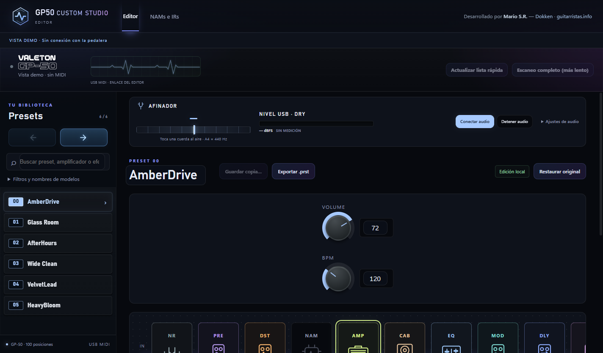
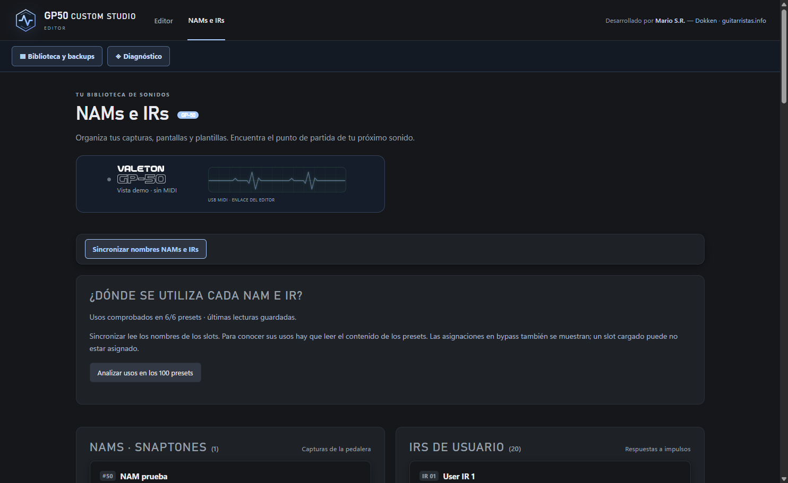
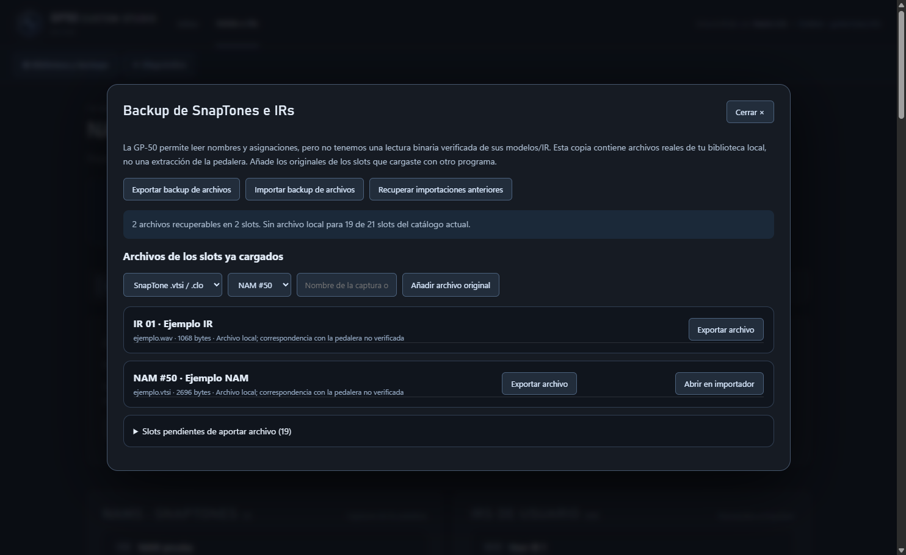
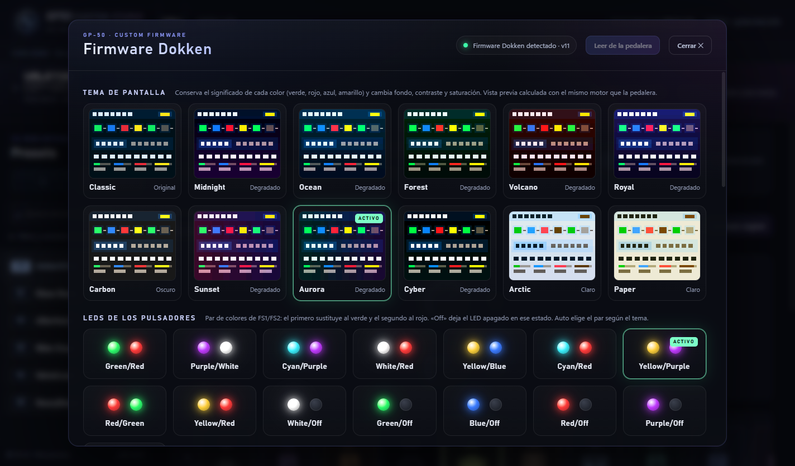
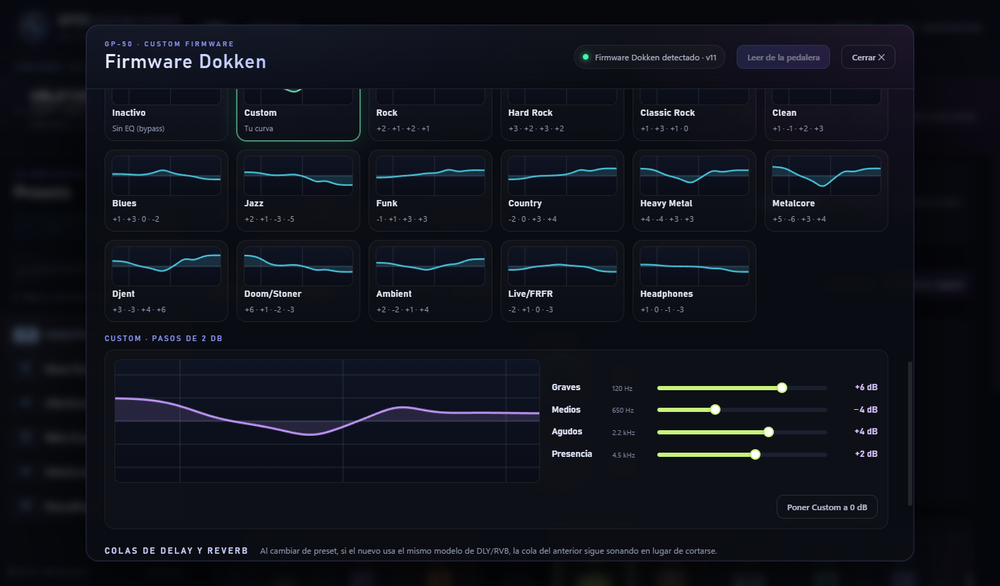
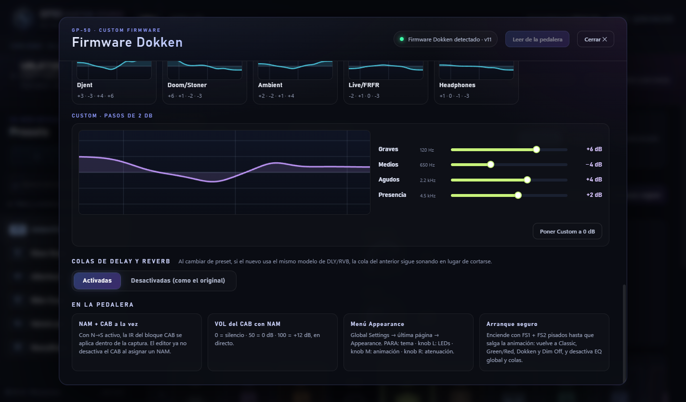
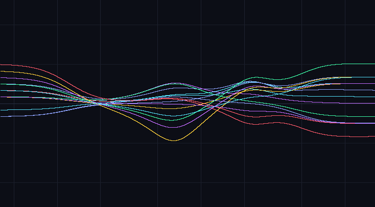
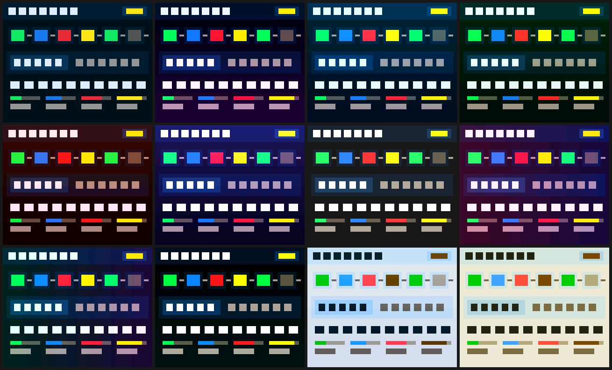
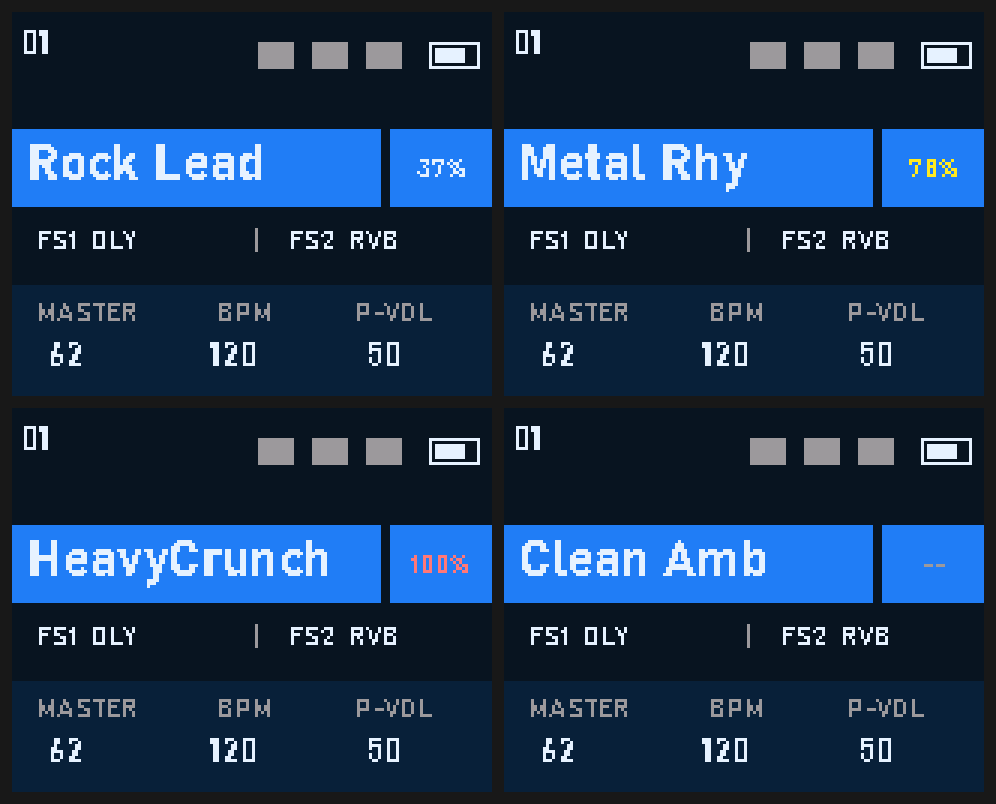
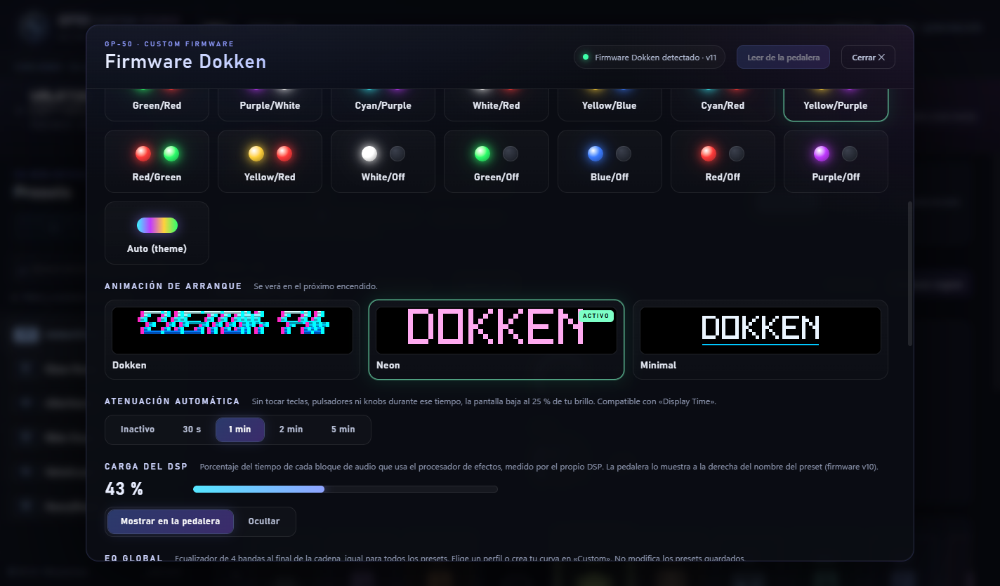

  

<h1 align="center">GP50 Custom Studio</h1>

  Editor de escritorio y <strong>GP-50 Custom Firmware by Dokken</strong> para Valeton GP-50. 
  Desarrollado por <a href="https://guitarristas.info/usuarios/dokken7789">Mario S.R. · Dokken</a>.

  <a href="https://gp50-custom-studio.pages.dev/">Web del proyecto</a> ·
  <a href="https://gp50-custom-studio.pages.dev/wiki.html">Wiki y guías</a> ·
  <a href="https://github.com/MarioSanzRodrigo/gp50-custom-studio/releases/tag/v0.9.2">Descargas 0.9.2</a> ·
  <a href="https://github.com/MarioSanzRodrigo/gp50-custom-studio/issues">Informar de un problema</a>

## Descargas

| Componente | Versión | Descarga |
|---|---|---|
| GP50 Custom Studio Editor | **0.9.2** · Windows 11 x64 | [Instalador .exe](https://github.com/MarioSanzRodrigo/gp50-custom-studio/releases/download/v0.9.2/GP50-Custom-Studio-0.9.2-Setup.exe) · [Código fuente](https://github.com/MarioSanzRodrigo/gp50-custom-studio/releases/download/v0.9.2/GP50-Custom-Studio-0.9.2-Sources.zip) |
| GP-50 Custom Firmware | **v11.1** · base oficial V1.1.0 | [Firmware .bin](https://github.com/MarioSanzRodrigo/gp50-custom-studio/releases/download/v0.9.2/GP-50_V1.1.0_NAMCAB_v11.1_GlobalEQ.bin) |

Consulta las instrucciones y notas `FIRMWARE-v11.1.md` incluidas en la release y las [guías de la wiki](https://gp50-custom-studio.pages.dev/wiki.html) antes de instalar el firmware.

## Editor

- **Presets y cadena visual:** selección de bloques y edición de parámetros desde el ordenador.
- **Afinador y nivel USB:** herramientas de audio integradas en el editor.
- **NAMs e IRs:** gestión de capturas y respuestas a impulsos, con TONE3000 integrado.
- **Copias de seguridad:** gestión de archivos y comprobaciones SHA-256.
- **Panel del firmware custom:** temas, LEDs, arranque, atenuación, carga del DSP, EQ global y colas.

| NAMs e IRs | Copias y archivos |
|:---:|:---:|
|  |  |

Las capturas del editor son vistas en modo demo. Puedes abrir cada imagen para verla a tamaño completo.

### Primeros pasos

1. Descarga e instala el editor para Windows 11 x64.
2. Cierra Valeton Suite y otros editores antes de conectar la GP-50.
3. Conecta la pedalera por USB y abre GP50 Custom Studio.
4. Consulta la [wiki](https://gp50-custom-studio.pages.dev/wiki.html) para la configuración y las funciones del firmware custom.

El instalador no tiene firma digital comercial.

## Firmware custom v11.1

- **NAM + CAB simultáneos**, con VOL del CAB hasta +12 dB.
- **EQ global de 4 bandas** para todos los presets: Off, Custom y 15 perfiles por estilo.
- **Colas de delay y reverb** entre presets.
- **Medidor de carga del DSP** junto al nombre del preset.
- **12 temas de pantalla**, **15 modos de LED**, **3 animaciones de arranque** y atenuación automática.
- Casillas **Appearance** y **Global EQ** en Global Settings.
- Arranque seguro (**A + B al encender**) y vuelta al oficial con el actualizador de Valeton.

### EQ global

| Perfiles de ecualización | Curva Custom y colas |
|:---:|:---:|
|  |  |

<strong>Ver perfiles, temas y animaciones del pedal</strong>

#### Perfiles de EQ

#### Temas de pantalla

#### Carga del DSP

#### Animaciones de arranque

| Dokken | Minimal | Neon |
|:---:|:---:|:---:|
|  |  |  |

Las vistas de pantalla y animaciones son previsualizaciones del firmware.

## Código fuente y licencias

Este repositorio contiene la documentación y las imágenes del proyecto. El **código completo del editor** se distribuye en `Sources.zip` en cada [release](https://github.com/MarioSanzRodrigo/gp50-custom-studio/releases). El «Source code» automático de GitHub contiene únicamente este árbol de documentación.

El editor se publica bajo **GPL-3.0-only**, con componentes MIT y los avisos de Electron/Chromium conservados. Consulta [LICENSE-GPL-3.0.txt](LICENSE-GPL-3.0.txt), [SOURCE-LICENSES.md](SOURCE-LICENSES.md) y [THIRD_PARTY_NOTICES.md](THIRD_PARTY_NOTICES.md). Información sobre datos en [PRIVACIDAD.md](PRIVACIDAD.md).

El firmware es una modificación del firmware oficial de Valeton, cuyos derechos pertenecen a Valeton.

## Autor y comunidad

Desarrollado por **Mario S.R. · [Dokken en guitarristas.info](https://guitarristas.info/usuarios/dokken7789)**. Para comunicar un problema, abre una [issue](https://github.com/MarioSanzRodrigo/gp50-custom-studio/issues) e indica la versión del editor, el firmware y los pasos para reproducirlo.

Proyecto independiente, sin vinculación oficial con Valeton. Sin garantía: lo instalas bajo tu responsabilidad.
